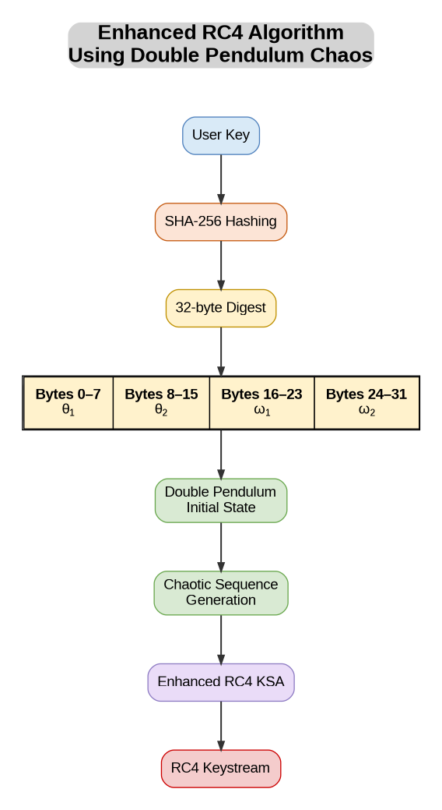
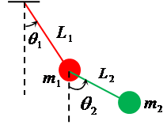
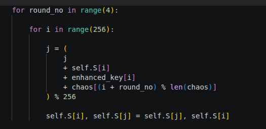
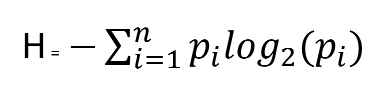
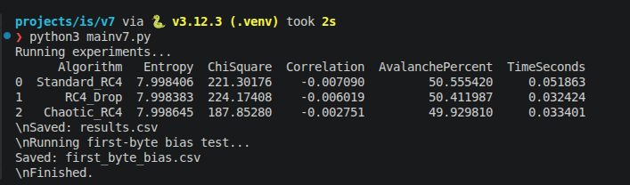
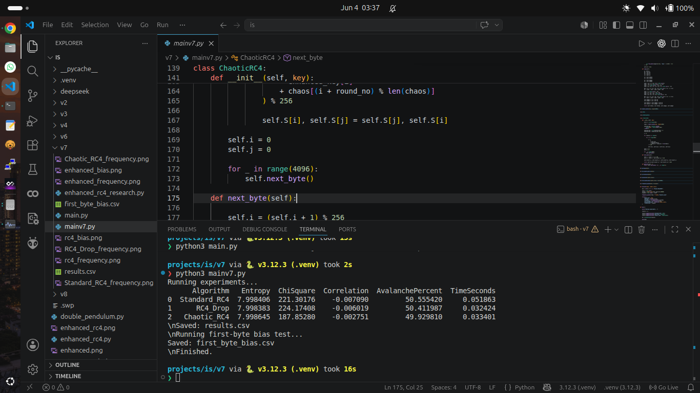

# Enhanced RC4 Using Double Pendulum Chaos

This project explores **enhancing the RC4 stream cipher using chaotic double pendulum-based key generation and modified key scheduling**. It compares standard RC4, RC4-Drop, and a chaotic RC4 variant using byte-distribution statistics, key sensitivity, and execution time, then provides an interactive text encryption/decryption tool.

The diagrams, code images, entropy formula, and example results below come from [Enhanced RC4.pptx](Enhanced%20RC4.pptx). The implementation details and additional equations describe the current [v7/mainv7.py](v7/mainv7.py).

## Setup and run

Use Python 3; the project has been checked with Python 3.12. Run these commands from the project root:

```bash
python3 -m venv env
source env/bin/activate
python3 -m pip install numpy pandas matplotlib scipy
python3 v7/mainv7.py
```

The `env/` directory is ignored by Git. In a new terminal, activate it again before running:

```bash
source env/bin/activate
python3 v7/mainv7.py
```

The program runs the experiments first, saves three frequency plots, prints a comparison table, and then opens the encryption/decryption menu.

## Algorithms compared

| Algorithm | Key scheduling | Initial keystream bytes discarded |
| --- | --- | ---: |
| Standard RC4 | One conventional KSA pass over a 256-entry permutation | 0 |
| RC4-Drop | Same KSA as standard RC4 | 3,072 |
| Chaotic RC4 | SHA-256-derived key and pendulum-derived bytes mixed through four KSA passes | 4,096 |

All three use the same RC4-style pseudo-random generation algorithm (PRGA) after initialization. The chaotic variant changes how the permutation is initialized and uses a longer initial drop.

## How the chaotic variant works



*Algorithm flowchart from slide 2.*

### 1. Derive the initial pendulum state from the key

The input key is converted to bytes and hashed with SHA-256. The 32-byte digest is split into four 8-byte, big-endian unsigned integers, denoted $u_0,u_1,u_2,u_3$:

| Digest bytes | State variable | Mapping |
| --- | --- | --- |
| 0–7 | First angle, $\theta_1$ | $2\pi u_0/2^{64}$ |
| 8–15 | Second angle, $\theta_2$ | $2\pi u_1/2^{64}$ |
| 16–23 | First angular velocity, $\omega_1$ | $20(u_2/2^{64}-1/2)$ |
| 24–31 | Second angular velocity, $\omega_2$ | $20(u_3/2^{64}-1/2)$ |

The initial angles lie in $[0,2\pi)$ radians and the angular velocities in $[-10,10)$ radians per second. This mapping makes the simulated initial state depend on the key.

### 2. Simulate the double pendulum



*Double pendulum model from slide 1.*

The model consists of two connected pendulums. Their state contains two angles and two angular velocities. The code uses $m_1=m_2=1$, $l_1=l_2=1$, $g=9.81$, and a timestep $\Delta t=0.01$ seconds.

The following equations transcribe `DoublePendulum.step()`. Define $\delta=\theta_1-\theta_2$ and $D=2m_1+m_2-m_2\cos(2\delta)$. The angular accelerations are:

$$
\alpha_1=\frac{-g(2m_1+m_2)\sin\theta_1-m_2g\sin(\theta_1-2\theta_2)-2m_2\sin\delta\left(l_2\omega_2^2+l_1\omega_1^2\cos\delta\right)}{l_1D}
$$

$$
\alpha_2=\frac{2\sin\delta\left[l_1\omega_1^2(m_1+m_2)+g(m_1+m_2)\cos\theta_1+l_2m_2\omega_2^2\cos\delta\right]}{l_2D}
$$

Each step updates angular velocities first, then angles using the updated velocities:

$$
\omega_k^{(t+1)}=\omega_k^{(t)}+\alpha_k^{(t)}\Delta t,
\qquad
\theta_k^{(t+1)}=\theta_k^{(t)}+\omega_k^{(t+1)}\Delta t,
\qquad k\in\{1,2\}.
$$

This is a semi-implicit Euler update. After each step, the four state values are formatted to 15 decimal places, concatenated without separators, encoded as text, and hashed with SHA-256. The 32-byte digests are concatenated until 4,096 bytes have been generated. These bytes are deterministic for the key and numerical execution; they are not an external source of random entropy.

### 3. Build the enhanced key and run four KSA passes

Let $K$ be the original key bytes and $B$ the 4,096-byte pendulum-derived sequence. The enhanced key digest is:

$$
E=\operatorname{SHA256}\left(K\mathbin{\|}B[0:256]\right),
$$

where $\|$ means concatenation. The 32-byte digest is repeated eight times to form the 256-byte array $E'$.



*Enhanced key scheduling algorithm from slide 3.*

Initialize $S[i]=i$ for $i=0,\ldots,255$ and $j=0$. For each pass $r=0,1,2,3$ and each index $i=0,\ldots,255$:

$$
j\leftarrow\left(j+S[i]+E'[i]+B[(i+r)\bmod4096]\right)\bmod256,
$$

then swap $S[i]$ and $S[j]$. The value of $j$ carries across passes. In the current indexing, the four passes directly access $B[0]$ through $B[258]$; the generated sequence has 4,096 bytes, but the KSA does not directly consume all of them.

### 4. Generate the keystream and encrypt

After key scheduling, reset the PRGA indices to zero. Each generated byte follows these operations in order:

$$
i\leftarrow(i+1)\bmod256,\qquad
j\leftarrow(j+S[i])\bmod256.
$$

Swap $S[i]$ and $S[j]$, then emit:

$$
z=S[(S[i]+S[j])\bmod256].
$$

The chaotic variant discards the first 4,096 generated bytes before producing usable output. Text is encoded as UTF-8 and XORed with the keystream:

$$
C_k=P_k\oplus Z_k,\qquad P_k=C_k\oplus Z_k.
$$

The tool displays ciphertext as hexadecimal. Decryption recreates the keystream using the same algorithm and key, applies XOR, and decodes the recovered UTF-8 bytes.

## Experiments and equations

Each algorithm generates a 100,000-byte stream using the fixed key `ResearchKey2026`. The timing includes cipher initialization and stream generation, and excludes plotting and statistical calculations. A separate avalanche comparison uses `SecretKey123`, flips one bit in its first byte, and compares two 4,096-byte streams.

### Shannon entropy



*Entropy formula from slide 6; slide 7 derives the uniform-byte maximum.*

For byte frequencies $p_b=n_b/N$:

$$
H=-\sum_{b:p_b>0}p_b\log_2p_b.
$$

A uniform distribution over all 256 byte values has $p_b=1/256$, so:

$$
H_{\max}=-256\left(\frac{1}{256}\right)\log_2\left(\frac{1}{256}\right)=8\text{ bits per byte}.
$$

An empirical value near 8 indicates a nearly uniform byte histogram. It does not measure all dependencies in the stream or establish cryptographic security.

### Chi-square statistic

The expected count for each byte value is $N/256$. The script reports:

$$
\chi^2=\sum_{b=0}^{255}\frac{(n_b-N/256)^2}{N/256}.
$$

This measures departure from uniform byte counts. The script returns the statistic and discards the p-value; a smaller statistic in one sample does not establish that one cipher is more secure.

### Adjacent-byte correlation

For $x=(z_0,\ldots,z_{N-2})$ and $y=(z_1,\ldots,z_{N-1})$, the script computes Pearson correlation:

$$
\rho=\frac{\sum_t(x_t-\bar{x})(y_t-\bar{y})}{\sqrt{\sum_t(x_t-\bar{x})^2\sum_t(y_t-\bar{y})^2}}.
$$

A value near zero indicates little linear correlation between adjacent byte values in the tested stream.

### Avalanche percentage

For two $L=4096$ byte streams $A$ and $B$ generated from keys differing by one bit:

$$
\operatorname{AvalanchePercent}=100\frac{\sum_{k=0}^{L-1}\operatorname{popcount}(A_k\oplus B_k)}{8L}.
$$

A value near 50% means about half the output bits changed in this comparison. The current experiment tests one key pair.

### Results shown in the presentation



*Result screenshot from slide 5. These are historical example measurements, not a fresh benchmark.*

| Algorithm | Entropy | Chi-square | Correlation | Avalanche (%) | Time (s) |
| --- | ---: | ---: | ---: | ---: | ---: |
| Standard RC4 | 7.998406 | 221.30176 | -0.007090 | 50.555420 | 0.051863 |
| RC4-Drop | 7.998383 | 224.17408 | -0.006019 | 50.411987 | 0.032424 |
| Chaotic RC4 | 7.998645 | 187.85280 | -0.002751 | 49.929810 | 0.033401 |

All three examples have entropy close to 8, small adjacent-byte correlation, and avalanche percentages close to 50%. The chaotic variant has the lowest chi-square statistic in this example. These observations describe the tested streams; they do not demonstrate resistance to cryptanalytic attacks. Execution times depend on the machine and run.

<details>
<summary>Full development screenshot from slide 4</summary>



The screenshot shows the earlier project layout and CSV/bias-test output. The current cleaned project runs `v7/mainv7.py`; CSV export and the first-byte bias experiment are disabled in its `main()` function.

</details>

## Generated output

The script overwrites these frequency plots in the directory where you run it:

```text
Standard_RC4_frequency.png
RC4_Drop_frequency.png
Chaotic_RC4_frequency.png
```

Each chart shows counts for byte values 0–255. The plots are ignored by Git when generated in the project root or `v7/`. The README images in `docs/images/` are preserved presentation assets, separate from these generated charts. Results are printed to the terminal; CSV export is currently disabled.

## Interactive encryption and decryption

After the experiments finish:

1. Select `1` for standard RC4, `2` for RC4-Drop, or `3` for chaotic RC4.
2. Select encryption or decryption.
3. Enter a nonempty key. Use an ASCII key for compatibility with all three implementations.
4. Enter plaintext to encrypt, or hexadecimal ciphertext to decrypt.

Use the same algorithm and key to decrypt. Plaintext supports UTF-8, but the menu strips leading and trailing whitespace from entered text and keys. Choose `4` at the cipher menu to exit.

## Scope and limitations

This is an experimental comparison, with deterministic key-derived simulation and a small set of statistical checks. The tool restarts the keystream for each message using the same key, has no per-message nonce, and does not authenticate ciphertext. The experiments do not establish suitability for protecting sensitive data.

The pendulum state uses floating-point arithmetic and hashes its formatted values. Matching results across different numerical environments has not been verified.

## Project files and presentation credits

```text
README.md                 Project explanation and usage
Enhanced RC4.pptx         Original presentation
v7/mainv7.py              Ciphers, simulation, experiments, and console menu
docs/images/              Six images extracted from the presentation
.gitignore                Environment, cache, and generated-plot exclusions
```


